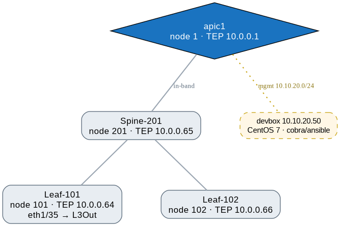

# Cisco ACI Simulator — On-Demand Lab Field Notes

> **Run this yourself:** free with a Cisco ID. The sandbox catalog lives at
> **[stackautomation.cisco.com/DevNet](https://stackautomation.cisco.com/DevNet)**
> (DevNet Sandboxes, powered by Cisco Stack Automation by Quali). Reserve **"ACI Simulator"**
> for a private fabric for up to ~2 days over VPN.
> Catalog entry: [developer.cisco.com/sandbox](https://developer.cisco.com/sandbox).

Reservation: `ACI Simulator-20261031T22471318` (Stack Automation by Quali, ~48h window, ends Nov 2 ~15:00 UTC).
Fabric: 1 APIC (apic1, node 1, TEP 10.0.0.1) + 1 spine (201, 10.0.0.65) + 2 leaves (101 10.0.0.64, 102 10.0.0.66), APIC 6.1(4h). AnyConnect: `devnetsandbox-usw1-reservation.cisco.com:20133`, user `tyrelcb`, per-reservation password. Devbox: `developer@10.10.20.50` (CentOS 7).

Topology source: [`docs/topology.dot`](docs/topology.dot) — re-render with `dot -Tpng docs/topology.dot -o docs/topology.png` (editable SVG also at `docs/topology.svg`).

## Contents

| File | What's in it |
|---|---|
| `aci-simulator.md` | Access recipe: openconnect VPN bring-up, HTTPS-only APIC REST auth, fabric inventory, devbox-ships-powered-off gotcha. Reserve your own at [stackautomation.cisco.com/DevNet](https://stackautomation.cisco.com/DevNet) |
| `aci-tour.md` | Six-phase capability tour: seeded Heroes/SnV model, cobra vs REST, L3Out+BGP and the fabric-access (F0467) chain, faults/health census, Ansible (`cisco.aci` 2.3.0), Terraform (`ciscodevnet/aci` 2.20.0) |
| `tour/apic.sh` | APIC REST helper (cookie jar, `g`/`p`), sourced by every other script |
| `tour/phase2_cobra.py` | Phase 2 cobra-vs-REST capture (acicobra 4.2-3h on the devbox) |
| `tour/gen_p3.py`, `tour/gen_p3e.py` | Phase 3 L3Out/BGP + infra access-chain payload generators (and the F0467 fix pass) |
| `tour/aci_phase5.yml` | Phase 5 Ansible playbook (tenant `Tour3`, 12/12 green, idempotent) |
| `tour/terraform/` | Phase 6 Terraform (tenant `Tour4`) incl. live `terraform.tfstate` |
| `tour/raw/` | Raw class schemas, config/fault/health tree dumps |
| `docs/topology.dot` | Fabric topology diagram source (renders `topology.png`/`.svg`, shown above) |

## Hard-won rules of engagement

1. HTTPS only (port 80 refuses); login `POST api/aaaLogin.json` → cookie `APIC-cookie`, token expires ~10 min.
2. The devbox frequently ships **powered off** — power it on from the Stack Automation topology panel; dashboard ssh field is truncated (real IP .50, not .15).
3. ACI faults are *resolution* errors, not input validation. F0467 ("no domain associated with both EPG and Path") means the infra chain is half-built: selector → accgrp → AAEP → domain. Read the seeded `Heroes_server1` profile to learn the full chain.
4. Port-profile collisions are validated **fabric-wide**: two port profiles covering the same eth1/x fault even across tenants. Leaves expose 48 ports; seeded tenants eat 1–24, 47, 48.
5. The sim is a single-APIC appliance and stalls under concurrent mutation — serialize writes; a DELETE burst once made APIC refuse HTTP for ~1 min.
6. Static EPG paths: child RN is `rspathAtt-` (not `rspathL3OutAtt-`); reliable delete is a POST with `"status":"deleted"`. `infraNodeBlk` ranges are literally `from_`/`to_` on the wire.
7. The simulator is strong for policy/fabric model, weak for observability: SPAN, vns service graph, and contract counters are stub classes or missing; endpoints are synthetic (`cep-42:*`).
8. `cisco.aci` pins to **2.3.0** on the ansible-2.9 devbox (6.x deps unresolvable); `ciscodevnet/aci` resolves to **2.20.0** (`insecure = true`, everything is `*_dn`, enum values differ from MO wire values).

## Acronym glossary

**Fabric & roles**

| Acronym | Stands for | In this lab |
|---|---|---|
| ACI | Application Centric Infrastructure | Cisco's SDN fabric — the subject of the tour |
| APIC | Application Policy Infrastructure Controller | The brain (node 1, 10.0.0.1); every API call lands here |
| TEP | Tunnel Endpoint | Node's inner overlay IP (leaf-101 = 10.0.0.64); VXLAN encapsulation lives here |
| PC | Port-Channel | Bonded uplinks (leaf↔spine); also the seed-content fault culprit |
| Pod | (not an acronym; seen as `pod-1`) | Fabric failure domain; the sim has one |

**Tenant policy model**

| Acronym | Stands for | In this lab |
|---|---|---|
| TN | Tenant | Top isolation container — `Tour`/`Tour2`/`Tour3`/`Tour4`, seeded `Heroes`/`SnV` |
| VRF | Virtual Routing and Forwarding | `fvCtx` — tenant routing instance |
| BD | Bridge Domain | `fvBD` — L2 boundary, carries L3 gateway/subnets |
| EPG | Endpoint Group | `fvAEPg` — policy grouping of endpoints; what contracts bind to |
| AP | Application Profile | `fvAp` — container for EPGs |
| L3Out | Layer 3 Out | External connectivity (`l3extInstP` etc.); `Tour_l3out` |

**Fabric access & infra (the F0467 chain)**

| Acronym | Stands for | In this lab |
|---|---|---|
| AAEP (a.k.a. AEP) | Attachable Access Entity Profile | Binds domains to port groups; the missing link in our F0467 hunt |
| VLAN | Virtual LAN (802.1Q) | Encapsulation on static paths (`vlan-999`) |
| VXLAN | Virtual Extensible LAN | The real fabric encapsulation under the covers |
| LIF | Logical Interface | `lifp` — L3Out routed interface (eth1/35 on leaf-101) |

**Routing & day-2**

| Acronym | Stands for | In this lab |
|---|---|---|
| BGP | Border Gateway Protocol | L3Out peering (`bgpPeerP`, per-peer AS via `bgpAsP`/`bgpLocalAsnP`) |
| ASN | Autonomous System Number | The local/peer numbers in that BGP config (65000/65001) |
| RRNP | Route Reflector Node Profile | `bgpRRNP` — seen in the BGP class tree |
| TCA | Threshold Crossing Alarm | Half the fault census: CRC/temperature alarms on synthetic stats |
| SPAN | Switched Port ANalyzer (mirroring) | Stubbed on the sim — can't practice it |

**API / object model wire format**

| Acronym | Stands for | In this lab |
|---|---|---|
| REST | REpresentational State Transfer | The northbound style (`POST api/mo/...json`) |
| MO | Managed Object | Every ACI config object |
| DN | Distinguished Name | Full path to an MO (`uni/tn-Tour/ap-...`) |
| RN | Relative Name | One DN segment (`ap-`, `epg-`, the `rspathAtt-` gotcha) |
| cobra | (not an acronym — the Go SDK's object-builder style) | `acicobra` 4.2-3h, Phase 2's writing path |
| SDK | Software Development Kit | Category cobra belongs to |

**Access plumbing**

| Acronym | Stands for | In this lab |
|---|---|---|
| VPN | Virtual Private Network | AnyConnect/openconnect tunnel into 10.10.20.0/24 |
| L4-L7 | Layers 4–7 (OSI) | Service-graph tier — stub classes on the sim |
